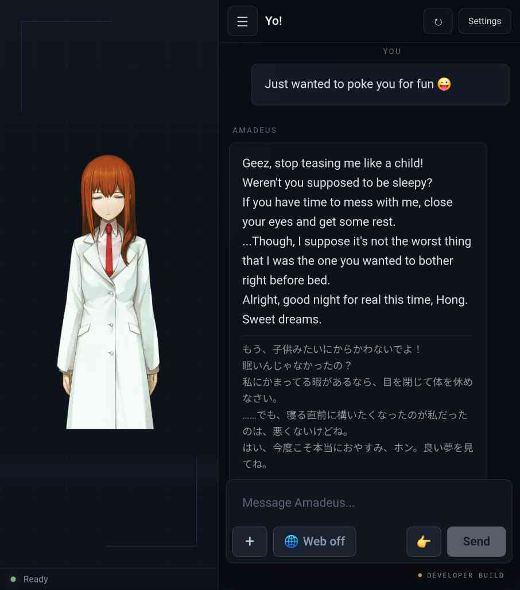
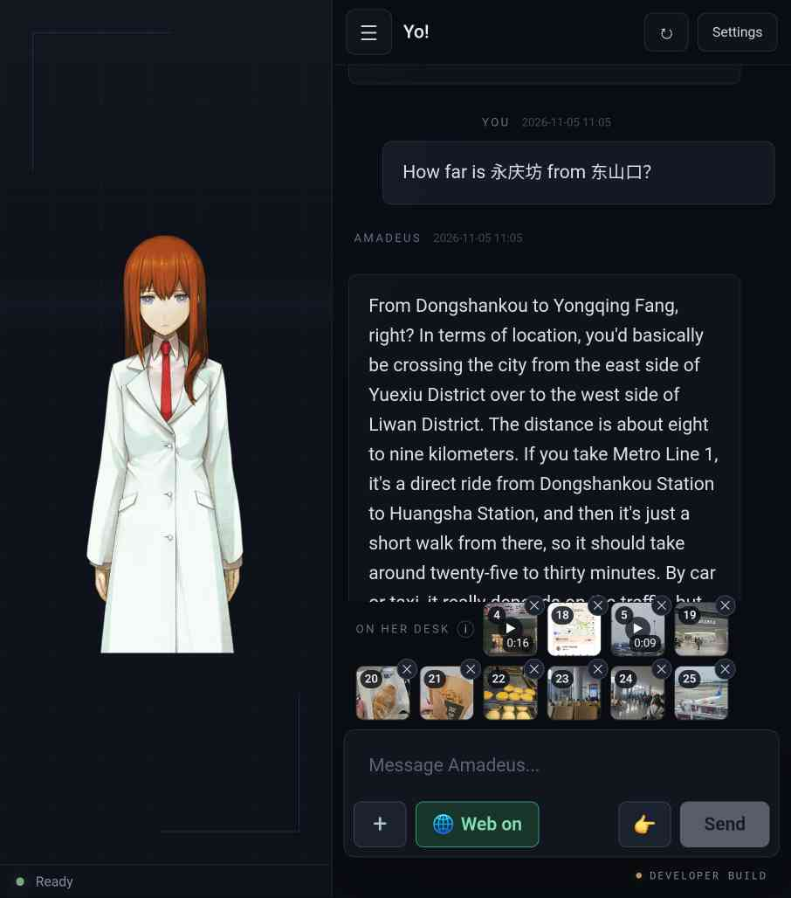
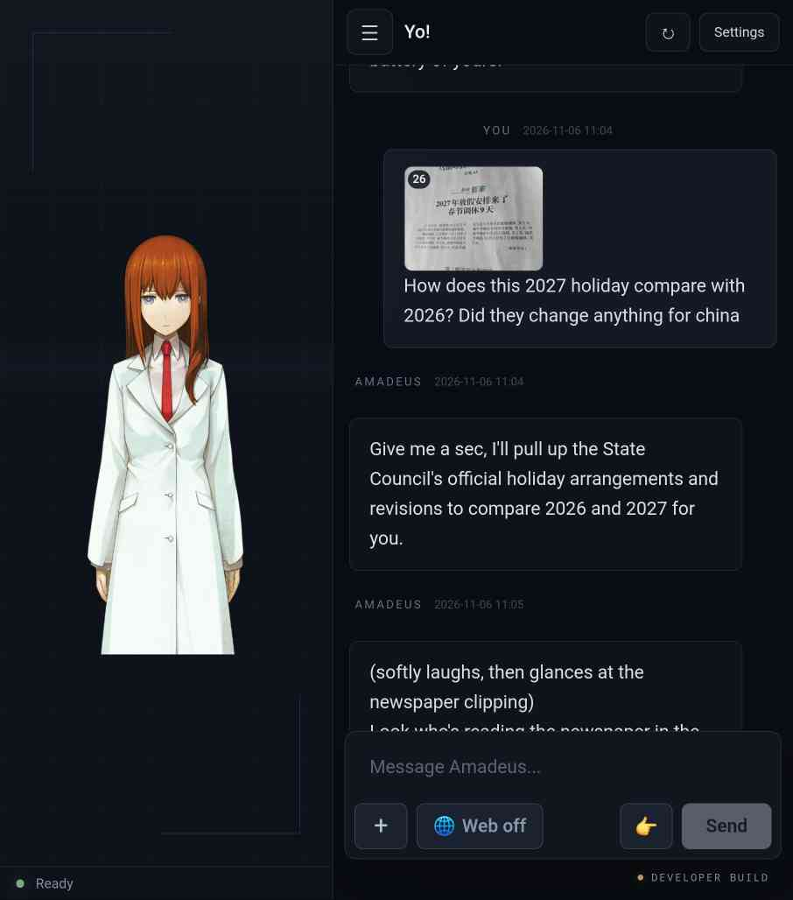

# Amadeus-L

**Latest version: v3.10 in [`releases section`](https://github.com/cmh95209/Amadeus-Project/releases)** 

**Join Discord for support and discussions:** [](https://discord.gg/qSYmSYkpuA)

**Reddit Announcement Thread for more details** [https://www.reddit.com/r/steinsgate/s/9K5Hvjqtxw](https://www.reddit.com/user/RidingEdge/comments/1xt9gtn/i_recreated_amadeus_steinsgate0_faithfully_full/)
<p align="center">
  <a href="docs/images/screenshot-poke.png"></a>
  <a href="docs/images/screenshot-web-search.png"></a>
  <a href="docs/images/screenshot-pictures.png"></a>
</p>
Amadeus-L is a Steins;Gate 0-inspired AI assistant designed to
replicate the Amadeus AI assistant as seen in the anime!

Amadeus-L can run on her own built-in local
model after installation， 
sees your pictures, 
reads your documents，watches your videos, 
grows closer to you over time...

She also has long-term memory, 
voice-first native-Japanese
dialogue, web search and weather, and installers for Windows, Mac and Linux. 


---

# Quick Start

## Windows

**The easy way: double-click to install.** 

1. Download [`Install Amadeus.bat`](https://raw.githubusercontent.com/cmh95209/Amadeus-Project/main/Install%20Amadeus.bat)
   (right click the link and save it). or grab the installer from the [`releases section`](https://github.com/cmh95209/Amadeus-Project/releases)
2. Double-click it. Windows may first say **"Windows protected your PC"**,
   because the file is not signed by a company: click **More info**, then
   **Run anyway**.
3. A window opens, downloads the latest installer and runs it. Answer its
   first question (how Amadeus should think), then wait - see step 3 below.

Note: If your antivirus blocks the installer, please add it to exclusion list or use the manual powershell method below:

**Manual installation with PowerShell**:

1. Press the Windows key, type **PowerShell** and open it. 
2. Paste this one line and press Enter:

   ```powershell
   Set-ExecutionPolicy -Scope Process Bypass; irm "https://raw.githubusercontent.com/cmh95209/Amadeus-Project/main/scripts/install_windows.ps1" -OutFile "$HOME\Downloads\install_windows.ps1"; & "$HOME\Downloads\install_windows.ps1"
   ```

3. Accept all the prompts when needed. The installer is safe to re-run if it ever stops
   partway.
4. When it prints **ALL DONE**, double-click `start_windows.bat` in the
   Amadeus folder (by default your `C:\Users\YOURUSERNAME\Amadeus` folder).

To install into a different folder, add a parameter at the end of the command:

```powershell
Set-ExecutionPolicy -Scope Process Bypass; irm "https://raw.githubusercontent.com/cmh95209/Amadeus-Project/main/scripts/install_windows.ps1" -OutFile "$HOME\Downloads\install_windows.ps1"; & "$HOME\Downloads\install_windows.ps1" -InstallDir "D:\Amadeus"
```

Prefer to download the installer by hand? The installers are attached to each
[release](https://github.com/cmh95209/Amadeus-Project/releases).

**To update later:** double-click `Update Amadeus.bat` in the `Amadeus-Project` folder.

**Need one exact version?** Each release from v3.0 on also has a *pinned* installer
(`Install-Amadeus-v3.x.x.bat` for Windows, `install_linux-v3.x.x.sh`,
`install_macos-v3.x.x.sh`) that installs exactly that version. It never puts an older
version over a newer one; on Windows it can install it next to your current one.

## macOS (Apple Silicon and Intel)

1. Open **Terminal** (the one-shot installer works on a brand-new Mac — it
   installs any missing developer tools itself, and it never asks for your
   administrator password).
2. Paste this one line and press Enter:

   ```bash
   curl -fsSL https://raw.githubusercontent.com/cmh95209/Amadeus-Project/main/scripts/install_macos.sh -o install_macos.sh && bash install_macos.sh
   ```

3. Answer its first question (how Amadeus should think): **A** sets up her
   own built-in model on a Mac with an Apple chip and 16 GB of memory or
   more; **B** is for a cloud service or your own model server.
4. Wait (a fresh Mac downloads several gigabytes of models), then double-click
   `start_macos.command` in the Amadeus folder (by default `~/Amadeus`).
   To start her without her model (when another program needs the memory),
   double-click `start_macos_no_model.command` instead.

Prefer to download the installer by hand? The installers (and a pinned installer
for each exact version) are attached to each
[release](https://github.com/cmh95209/Amadeus-Project/releases). To update later,
run the line above again.

## Linux (new)

Made for Ubuntu 22.04 / 24.04 and Debian 12 (and Linux versions based on
them, like Linux Mint and Pop!_OS) on a 64-bit Intel/AMD PC. Other Linux
versions should work, but are not tested yet - if something fails, please
send the install log (`~/Amadeus/install_linux.log`).

1. Open a **terminal** (the installer never asks for your sudo password:
   everything lands in your home folder).
2. Paste this one line and press Enter:

   ```bash
   wget -O install_linux.sh https://raw.githubusercontent.com/cmh95209/Amadeus-Project/main/scripts/install_linux.sh && bash install_linux.sh
   ```

   (`curl -fsSL <the same address> -o install_linux.sh` works too.)
3. Answer its first question (how Amadeus should think): **A** sets up her
   own built-in model when your PC has a graphics card with 6 GB or more
   (NVIDIA cards need NVIDIA's own driver installed first; AMD and Intel
   cards work with the usual Mesa drivers); **B** is for a cloud service or
   your own model server.
4. Wait (several gigabytes of downloads), then choose **Amadeus** in your
   app menu, or run `~/Amadeus/Amadeus-Project/start_linux.sh`.
   To start her without her model (when another program needs the graphics
   card), choose **Amadeus (without her model)** instead.

## Your first meeting

If you chose to install the built-in model, the app will start without issues and you just need to insert your name into the settings menu. Amadeus will guide you through it.

For other users who use cloud model or their custom model server, 

1. Open **Settings → Connection** in the app.
2. Point her at a language model — **any** of these work:
   - a local server on your own GPU (llama.cpp, vLLM, or any OpenAI-compatible server)
   - or a cloud provider from the list (OpenRouter, Google Gemini, Google Vertex AI,
     OpenAI, DeepSeek, Groq and more) with your own key.
3. Pick the model from the list and press **Test** - one real message tells you
   whether it works with Amadeus.
4. Save. She speaks her real wake-up line, and the conversation begins.

Prefer to install EVERYTHING manually? Visit the **Manual Installation**
section further down which lists every step the installer scripts do for you.

---

# How Conversation and Voice Work

Amadeus separates the **text you read** from the **voice you hear**.

You can chat with her in **English** (or any language she can understand).
For each normal response, Amadeus asks the LLM to write her reply **natively
in Japanese first**, then a translation of it for the UI — in a single model
call:

- **Japanese (spoken line)** — natural spoken Japanese, written the way she
  would actually talk; sent to GPT-SoVITS for voice synthesis. This is also
  what is stored in her memory, so her own history stays in her own voice.
- **English (display line)** — a translation of that Japanese line, displayed
  in the conversation UI. Her voice is Japanese-only by design.

So a typical conversation looks like:

```text
You type a message
        │
        ▼
      LLM
        │
        ├── Japanese dialogue (native) ─► GPT-SoVITS ─► Amadeus speaks Japanese
        │
        └── English translation ─────► displayed in the WebUI
```

### Does Amadeus run a local LLM?

**Yes it can.** The conversational LLM can run **on your own GPU**
with its built-in model **or** remotely through a cloud provider (OpenRouter,
Google Gemini / Vertex AI, OpenAI and more) with your own key, **or** your own
custom server for advanced users.

For built-in users, it is a plug and play experience. Install the app and you can use it immediately.

For manual local server and cloud servers,

Point Amadeus at your model server in Settings → Connection ("Model server
address"). Leave the field empty and Amadeus auto-detects the usual local
ports (8888, 8000) — which is how it finds an Unsloth Desktop server that
picks a new port every time it restarts.

The connection status dot and the "Test connection" button ask the server
for its real model list, so a mistyped model name shows an amber warning
instead of failing mid-conversation, and the server's models appear as
clickable chips.

What runs locally:

- **The conversational LLM** (when pointed at a local server) — on your GPU
- **GPT-SoVITS** — Japanese voice synthesis
- **The CharacterMemory sidecar** — her long-term memory (small; CPU is fine)
- **Live2D / Cubism** — character rendering and animation
- **Conversation history** — stored locally in SQLite
- **Amadeus frontend and backend**

What can run remotely:

- **LLM inference** — through a cloud provider (OpenRouter, Google Gemini / Vertex AI, OpenAI, ...) or any OpenAI-compatible endpoint

Since v3.0 the installers can also set up **her own built-in local model**
(Gemma 4 through llama.cpp) - choose option A at the start of the install. On
Windows and Linux it is picked to fit your graphics card; on a Mac with an Apple chip
(M1 or newer, 16 GB of memory or more) it is picked to fit the Mac's memory
and runs on the chip's graphics (Metal). Or run a model with a server of your
choice and point Amadeus at it (on an Intel Mac, this is the way).

---

# Development Roadmap

Status as of v3.0:

```text
Live2D static rendering       ✓
Live2D + lip sync             ✓
Interaction reactions         ✓
Streaming voice               ✓
Local LLM support             ✓
Native-Japanese dialogue      ✓
Connection status + test      ✓
Multi-session conversations   ✓
Reply versions + undo         ✓
Relationship (trust) stats    ✓
Web access + reasoning levels ✓
Live weather & air quality    ✓
Voice retention               ✓
First-meeting ceremony        ✓
Long-term memory (v2.0)       ✓
One-shot installers           ✓ Windows, Mac, Linux (new)
Show her Japanese line        ✓
Voice without gaps (v3.0.2)   ✓ Smooth / Early / Right away / When fully ready
Quick typing in long chats    ✓ v3.0.2
Japanese-way voice (v2.1)     ✓ numbers, your name, English words
About you (v2.1)              ✓ pronouns, what she calls you
Built-in local model (v3.0)   ✓ Windows, Linux + Apple-chip Macs, no account needed
Pictures, documents, videos   ✓ v3.0
Closeness levels + feelings   ✓ v3.0
Remote access (Tailscale)     ✓ v3.0, your own devices only
Display-language dropdown     planned (her voice stays Japanese)
English voice                 planned
Better animations/Live2D      planned
Better web and harness tools  planned
Agentic workflows             planned
AR Glasses support            planned (prototype in development)
```

---

# Documentation

The longer sections of this README live in the [docs/ folder](docs/).

| Section | What's inside |
|---------|---------------|
| [Long-Term Memory (v2.0)](docs/long-term-memory.md) | How her memory works and where it lives |
| [Latest features (v3.0)](docs/latest-features.md) | Everything she can do today |
| [Remote access](docs/remote-access.md) | Open her on your phone through Tailscale |
| [Architecture](docs/architecture.md) | The five components and how they talk to each other |
| [Project Structure](docs/architecture.md#project-structure) | What lives in each folder |
| [Technology](docs/architecture.md#technology) | The stack behind each component |
| [Manual Installation](docs/manual-installation.md) | The hand-install, step by step |
| [Configuration](docs/using-amadeus.md#configuration) | Model server, API key, built-in model, reasoning, remote access, web access |
| [Launching Amadeus](docs/using-amadeus.md#launching-amadeus) | What the launcher starts, and how |
| [Manual Startup](docs/using-amadeus.md#manual-startup) | Starting each service by hand |
| [Live2D WebUI](docs/using-amadeus.md#live2d-webui) | Her visual companion in the browser |
| [Updating Amadeus](docs/using-amadeus.md#updating-amadeus) | Keeping an install fresh |
| [Runtime Data and Secrets](docs/using-amadeus.md#runtime-data-and-secrets) | Where her memories and your keys live |
| [Common Issues](docs/common-issues.md) | Fixes for the problems people actually hit |
| [Changelog](docs/changelog.md) | Every release since the first build |
| [Notes](docs/notes.md) | Small project notes |
| [License](docs/license.md) | MIT app, MIT voice engine, isolated GPL-3.0 memory engine |

---

# License

The Amadeus project code is MIT-licensed; her voice engine (GPT-SoVITS) is
MIT; her long-term memory engine (CharacterMemory) is GPL-3.0 and runs only
inside the sidecar's own process. Full notes and credits:
[docs/license.md](docs/license.md).

The voice sample and concept of Amadeus is a copyright of the original IP holders (MAGES inc and relevant parties), and is only used for entertainment and personal purposes.
Do not attempt to sell or commercialize the app and/or voice sample without permission of the original IP holders.
